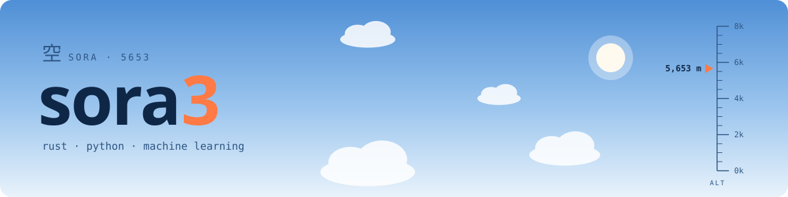

<picture>
  <source media="(prefers-color-scheme: dark)" srcset="assets/banner-dark.svg">
  
</picture>

### 空 / sora — Hi, I'm **Sora-5653**, aka **sora3**.

I write code at the meeting point of fast systems and learning systems:
**Rust** for things that need to be quick and safe, **Python** for experiments,
and **machine learning** for the problems in between.

```text
altitude   5,653 m        # the number in my name, read as height
stack      rust · python · ml
status     learning, building, shipping small things
```

#### Stack


#### Reach me

| | |
|---|---|
| Email | `eddy.forever5653@gmail.com` |
| Discord | `s_5653` |

<sub>☁ 5653 m above sea level, and still climbing.</sub>
